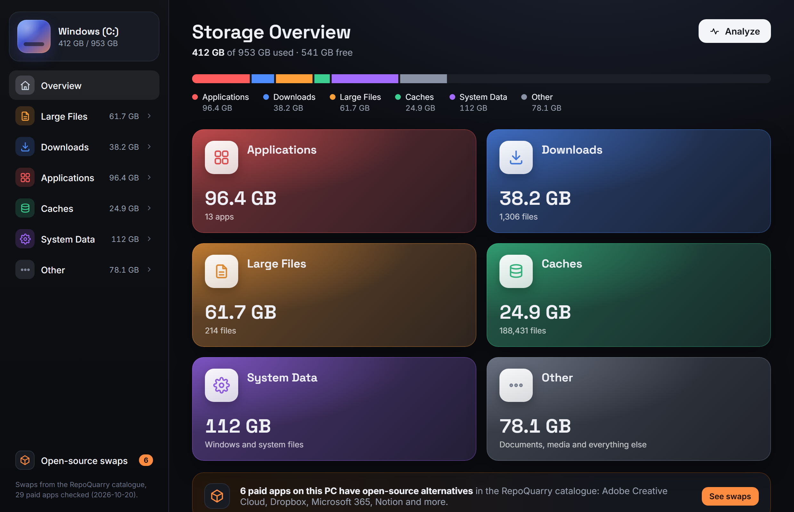
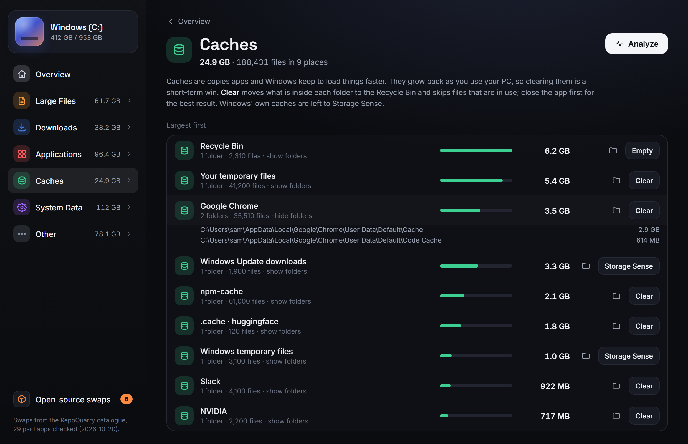
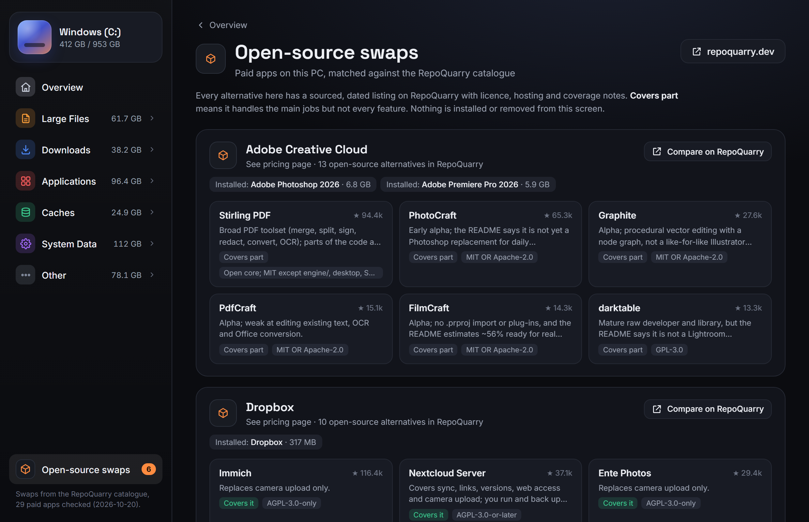
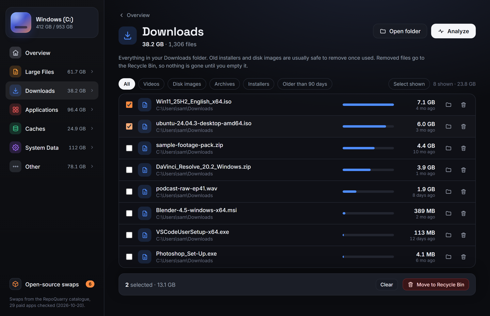
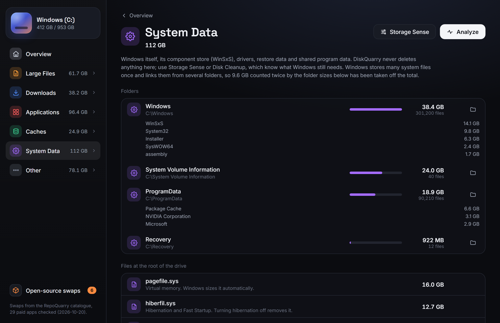

# DiskQuarry

**See what is filling your Windows drive.** Apps, downloads, large files, caches and system data in one dashboard, plus open-source swaps for the paid apps it finds, from the [RepoQuarry](https://repoquarry.dev) catalogue.



- **One pass, every byte counted once.** A parallel Rust scanner sorts each file into exactly one category, so the bar adds up to what Windows says is in use. On a 1 TB drive with 2.2 million files it finished in 9 s warm (41 s cold) and was within 0.2% of the used space Windows reports.
- **Six categories:** Applications, Downloads, Large Files (100 MB and up), Caches, System Data, Other.
- **Safe by default.** Nothing is ever deleted outright. Files and cache contents go to the Recycle Bin after a confirmation, Windows, Program Files and ProgramData are refused by the backend, and uninstalling goes through Windows Settings.
- **Open-source swaps.** Installed paid apps (Adobe, Microsoft 365, Slack, Notion, Dropbox, Zoom and 23 more) are matched to sourced alternatives listed on RepoQuarry, with licence, stars and how much of the job each one covers.
- **Small and native.** Tauri 2 + Rust, WebView2 UI, no telemetry, no network calls. The installer is a few megabytes.

Windows 10 and 11 only, for now.

**Known limits in 0.1.0:** Microsoft Store (MSIX) apps such as the Store versions of Zoom or ChatGPT are counted in Applications by size but are not listed by name, so they are not matched for swaps. The scan runs as your user, so folders that need administrator rights are counted from the drive total rather than read.

## Download

Grab the latest installer from [Releases](https://github.com/Obiwayne/DiskQuarry/releases):

- `DiskQuarry_x.y.z_x64-setup.exe`: per-user installer, no admin rights needed
- `DiskQuarry_x.y.z_x64_en-US.msi`: for managed installs

The app is not code-signed yet, so SmartScreen may show "Windows protected your PC". Choose **More info → Run anyway**, or build it yourself (below).

## What each view shows

| View | What is in it | What you can do |
|---|---|---|
| Applications | Program Files, game libraries (Steam, Epic, Xbox) and every install folder registered in the Uninstall registry keys | Open install folder, uninstall via Settings, see swaps |
| Downloads | Your Downloads folder, largest first, filters for videos, disk images, archives, installers, or older than 90 days | Show in Explorer, move to Recycle Bin (one or many) |
| Large Files | Single files of 100 MB or more that are not in any other category | Same as Downloads |
| Caches | Browser, app, developer (npm, pip, uv, Gradle, Hugging Face) and Windows caches, grouped by app; the Recycle Bin | Clear contents (folder kept, in-use files skipped), empty Recycle Bin, Storage Sense for Windows caches |
| System Data | `C:\Windows`, ProgramData, restore points, `pagefile.sys`, `hiberfil.sys` | Look only. Storage Sense button |
| Other | Documents, media, projects; also space that needs admin rights to read | Show in Explorer |
| Open-source swaps | Paid apps on this PC that RepoQuarry lists alternatives for | Open the RepoQuarry listing or GitHub repo |

| | |
|---|---|
|  |  |
|  |  |

Screenshots use the built-in demo data (open `ui/index.html` through any static server to see it), not a real drive.

## Build from source

Needs Windows 10/11, [Rust](https://rustup.rs) (MSVC toolchain), Node 20+ and the Visual Studio C++ build tools.

```bash
npm install
npm run dev      # run with hot reload
npm test         # Rust unit tests for the scanner rules
npm run build    # release exe + MSI + NSIS installer in src-tauri/target/release/bundle
```

Full-drive smoke test, prints category totals for `C:\`:

```bash
cargo test --release --manifest-path src-tauri/Cargo.toml -- --ignored --nocapture
```

### Refreshing the RepoQuarry catalogue

`ui/catalog.json` is generated from the RepoQuarry data files and committed, so the app builds without them. To refresh it with a RepoQuarry checkout next to this one:

```bash
npm run catalog                       # reads ../RepoQuarry/data
node scripts/build-catalog.mjs <path>  # or point it elsewhere
```

The list of paid desktop apps and the installed-program names that identify them is in [`scripts/build-catalog.mjs`](scripts/build-catalog.mjs).

## How it works

See [docs/how-it-works.md](docs/how-it-works.md) for the classification rules, how hard links and OneDrive placeholders are handled, and the safety checks.

## Credits

- Built with [Tauri](https://tauri.app), [rayon](https://github.com/rayon-rs/rayon), [sysinfo](https://github.com/GuillaumeGomez/sysinfo), [trash](https://github.com/Byron/trash-rs), [winreg](https://github.com/gentoo90/winreg-rs) and [dirs](https://github.com/dirs-dev/dirs-rs).
- Fonts: Inter and Space Grotesk (SIL Open Font License), the same faces RepoQuarry uses.
- Layout inspired by NivoMac's storage overview for macOS. DiskQuarry is an independent project and shares no code with it.
- Open-source alternatives data: [RepoQuarry](https://repoquarry.dev), where every fact has a source and a date.

## Licence

MIT. See [LICENSE](LICENSE).
